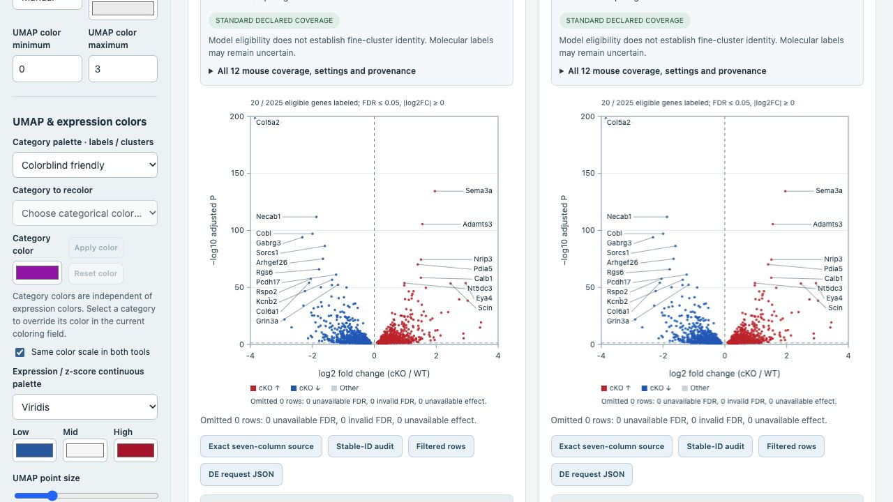
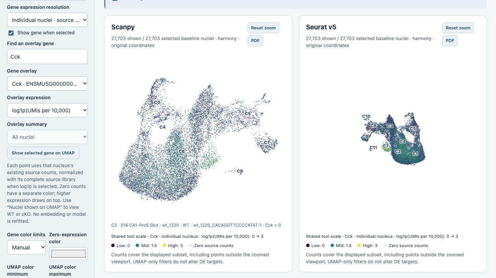

# Atlas v3.1 live-browser acceptance

All requested controls were exercised on the published HTTPS atlas on 17 October 2026, after deployment of `atlas-v3.1.1`.

Category palettes and a selected category override changed both CA1 maps. Short and custom display labels retained uncertainty, source annotations and exact saved DE membership. Individual Cck expression loaded from the original and paired CellBender branches; raw UMI and complete-library log1p modes, zero color and manual limits responded.

The 75-gene screenshot preset retained its exact sequence. Reverse, A–Z, pasted and focused-cluster ordering responded. Both dotplot PDFs contain all 75 genes on their first plot page; Seurat’s additional label/provenance notes continue on page 2. Volcano plots show numeric axes, 20 eligible labels and custom red/blue DEG colors. Eight PDF downloads parsed; the exported volcano and75-gene dotplot page were rendered and inspected.

Both downloaded total CA1 source DEG tables have 16,255 genes and exactly the requested seven columns. Their bytes match the unchanged saved source text. New controls survived reload; the user’s initial inhibitory 75-gene view was then restored through settings import. No browser console errors or warnings were present.

- [Controls guide](ATLAS_V3_1_CONTROLS.md)
- [Detailed receipt and file hashes](atlas_v31_browser_acceptance.json)
- [Remote expression-file integrity](atlas_v31_remote_expression_acceptance.json)

