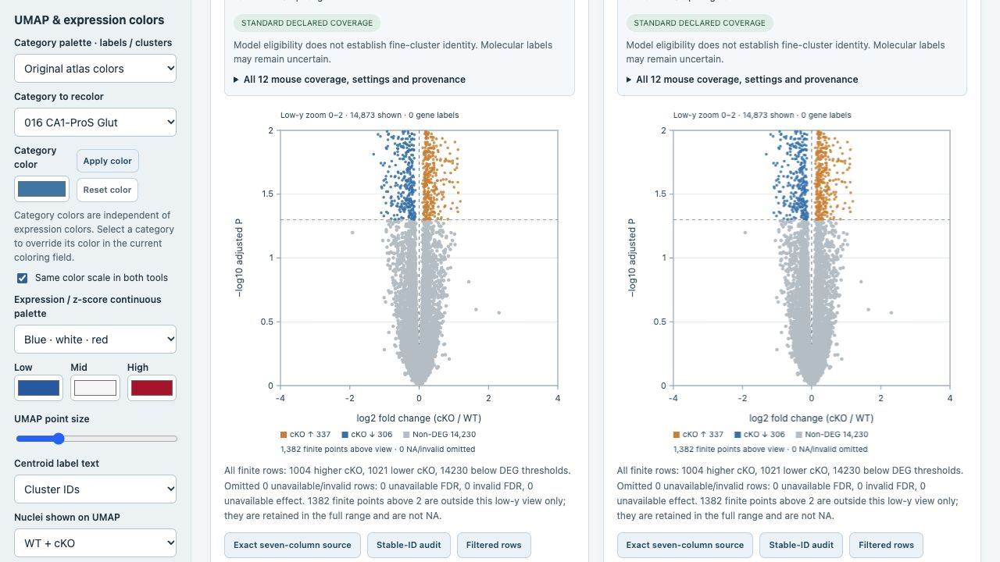
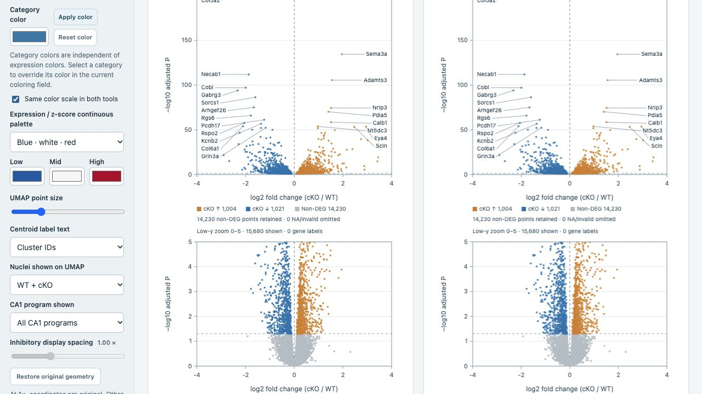

# Visible non-DEGs and low-y volcano acceptance

Live browser checks passed on 17 October 2026 for `atlas-v3.2.0`. Both Scanpy and Seurat show the same display controls and visibly light-gray non-DEGs in a separate low-y panel. Full, low-y-only and combined views operate in the browser and their PDFs.

The unchanged CA1 total example contains 16,255 finite genes: 1,004 higher in cKO, 1,021 lower in cKO and 14,230 below the selected DEG thresholds. At low-y maximum 5, the detail panel shows 15,680 finite points and reports 575 above the view. At maximum 2, it shows 14,873 and reports 1,382 above. All 14,230 non-DEGs remain visible in both low-y examples; unavailable adjusted P values remain a separate category.

Six PDF downloads cover all three views in both tools. All six are one-page documents; combined view uses A4 portrait, single views A4 landscape. The combined Scanpy PDF and low-y Seurat PDF were rendered and inspected for point visibility, numeric axes, labels, captions and page boundaries. An additional customized PDF confirms low-y maximum 2, radius 2.2 and opacity 1. Those controls persisted after reload. The user's original inhibitory 75-marker view was restored through settings import. Browser console errors/warnings: 0.

No source data, saved DESeq2 result, membership or DEG threshold changed. Existing table search filters are independent of the plot's y limit.

- [Controls guide](ATLAS_V3_1_CONTROLS.md#full-and-low-y-views-v32)
- [Detailed checks and PDF hashes](atlas_v32_browser_acceptance.json)

