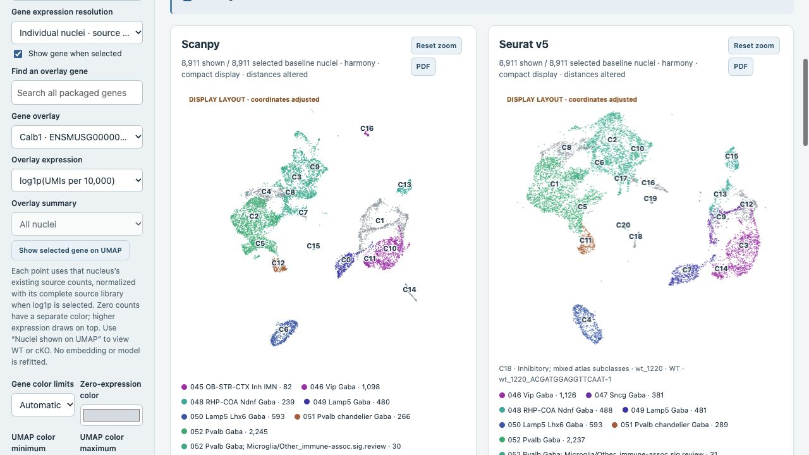
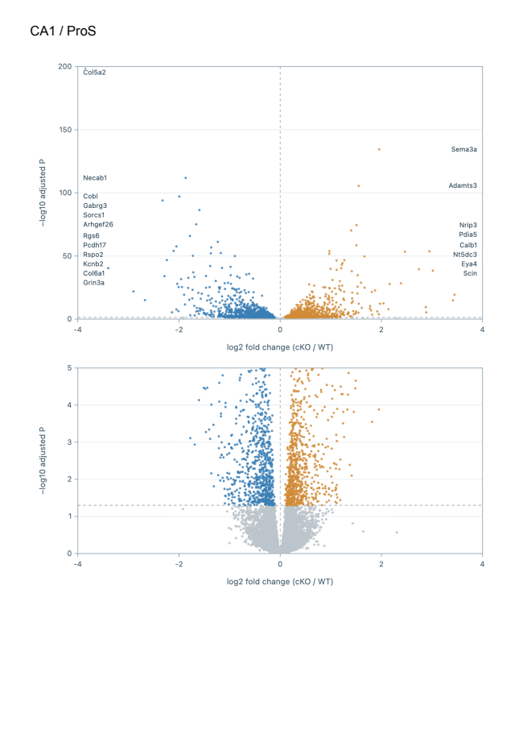

# Atlas v3.3.1 live verification

The [deployed atlas](https://ali-mujahid.github.io/satb2_snRNA/) passed the presentation controls and PDF checks recorded in [the receipt](atlas_v33_browser_acceptance.json). The publication completed in [GitHub Actions](https://github.com/Ali-Mujahid/satb2_snRNA/actions/runs/39073047726).

The C4 test changed only the display coordinates of its 593 Seurat nuclei; all other exported positions were unchanged. All 2,775 marker export rows kept their saved expression, detection and count values while the requested glyph size, opacity and hiding changed. Clean PDFs from both tools were downloaded and rendered. They keep the nucleus category, axes and gene names, with no gene leader lines or surrounding fit/settings paragraphs. Source provenance remains in downloadable data/settings and PDF properties.

Compact, manual and C-shaped schematic layouts are explicitly marked. The schematic arranges clusters by ID and does not assign observed anatomical positions. No QC, clustering, annotation or DESeq2 analysis was rerun. All source payloads and source measurement catalogs remain unchanged. The user’s earlier view and 75-marker selection were restored, with temporary dot styles cleared.

