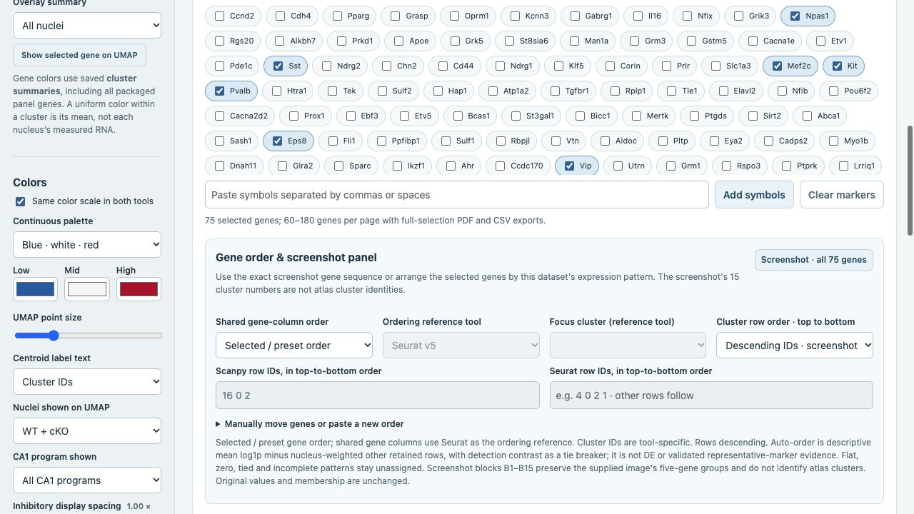

# Screenshot marker panel and ordering · v3

The offline and web atlases provide the same **Screenshot · all 75 genes** preset for Scanpy and Seurat. All 75 genes are available in every existing tool, count branch and population view. The marker registry now has **889 genes**: the original 878 plus eleven descriptive expression summaries added from existing full-gene integer-count objects.

## Reproduce the screenshot's gene sequence

1. Open **Marker expression** and choose the population and count branch.
2. Click **Screenshot · all 75 genes** in **Gene order & screenshot panel**. The same panel is also in the marker-preset selector.
3. The preset selects all 75 genes in exact left-to-right image order, uses a 90-gene page so the panel fits on one page, and selects descending cluster IDs for the row display. **Selected / preset order** retains that gene sequence.
4. Choose the expression/z color limits and palette, then use each tool's **PDF · full selection** button to export its plot.

The separators B1–B15 retain the image's original five-gene blocks. They are presentation groups. The source screenshot's numbered clusters do not correspond automatically to Scanpy or Seurat cluster IDs in this study. Gene expression patterns and cluster numbers will therefore differ from the reference image even with the exact same gene sequence.

## Arrange genes by this study's cluster patterns

Choose **Group by cluster expression pattern** in **Shared gene-column order**, then choose **Scanpy** or **Seurat v5** as the **Ordering reference tool**. The selected tool determines one column order used in both panels, so a gene stays in the same position when comparing tools. The other tool's clusters do not acquire the reference tool's identities.

For each selected gene, the descriptive criterion compares a displayed row's mean log1p expression with the nucleus-weighted mean of all other retained displayed rows. A unique positive strongest contrast determines the row's gene block. Detection contrast breaks ties; genes within a block are ordered by contrast. Flat, zero, tied or incomplete expression patterns remain unassigned. Exclusions and custom label unions change the displayed rows used for this descriptive calculation.

This uses existing expression values. It does not calculate P-values, select new statistically validated representative markers, change the cluster definition or modify any saved DEG result. The ordering criterion remains mean-expression contrast even when dot color is set to z-score or detection fraction.

Choose **Focus cluster expression contrast** to rank the selected genes for one row from the reference tool. Select that row in **Focus cluster (reference tool)**. Both panels still use the same ranked gene columns.

## Manual gene and cluster order

Expand **Manually move genes or paste a new order**. You can:

- Paste symbols or stable gene IDs into **Gene order**, then click **Apply pasted order**. This reorders selected genes; omitted selected genes follow in their current selection order. Unselected or unrecognized names are reported rather than silently added.
- Use **Freeze displayed order for editing** after automatic ordering. It stores the displayed sequence as the selected order.
- Choose one gene and move it **First**, **Left**, **Right** or **Last**. A move switches to selected order and applies to both panels.

For cluster rows, choose ascending IDs, descending IDs or **Custom cluster IDs**. Custom Scanpy and Seurat row lists are separate and read from top to bottom. Unlisted rows follow. These controls change display order, not annotations or memberships.

Use **Export settings** to preserve marker selection, ordering mode, reference tool, focus row and custom row lists for another session or computer. Exported settings include the displayed marker-order snapshot. **Download full selected values** includes expression values plus gene/row display order and descriptive-order metadata. PDF exports retain the chosen order across all selected pages. These are local downloads; settings and labels are not uploaded to the repository.

## What was added and what stays fixed

New symbols: `Unc5c Cpne5 Nrxn1 Tcf4 Fgf12 Ptpre Gria4 Gria1 Ctnnd2 Mgat4c Ptprd`.

The extension covers 24 tool × branch × source-population combinations, with ALL, WT and cKO summary scopes. CA1 programme/sublayer views use the same frozen CA1-ProS source atoms. Each nucleus is normalized by its complete selected-source library before log1p; corrected CellBender uses its corrected full-gene library. The original summary functions and reference-scaling definitions are retained. cKO z-scores remain unavailable under the existing contract, so use mean expression for that scope.

All original 878 marker rows are preserved exactly. All **64,548** added gene × atom × mouse integer sums agree exactly with the **489** existing full-gene native atomic count arrays. Source counts, masks, memberships, QC, embeddings, cluster labels, full-gene mouse boxplots and DESeq2 fits are unchanged. See [the extension provenance and validation](../analysis/dashboard/v3_marker_extension/README.md).

## Portable files and historical results

Download `SATB2_atlas_v3_runtime.zip` and `SATB2_atlas_v3_saved_results.zip` from [atlas-v3.0.0](https://github.com/Ali-Mujahid/satb2_snRNA/releases/tag/atlas-v3.0.0). Extract both into the same parent folder so their common `offline_dashboard_v3/` root merges, then open `index.html`. The runtime is self-contained and uses the classic offline loader; no R, Python, server or network is needed to explore it. The companion retains the prior saved figures and result files under the v3 root.

The web atlas uses the same marker summaries and controls. Original DE/source-download payloads remain pinned to `atlas-v2.1.0`; the new marker release does not change that historical data reference. Earlier v2/v2.1 archives, native figure books, processed objects and other legacy assets remain available from the [earlier release](https://github.com/Ali-Mujahid/satb2_snRNA/releases/tag/atlas-v2.1.0).
